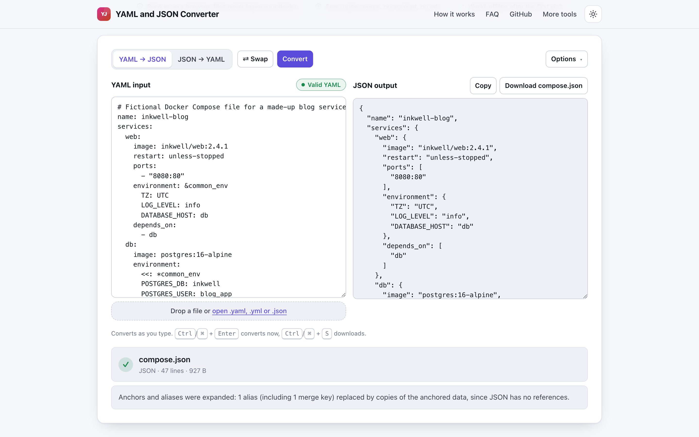
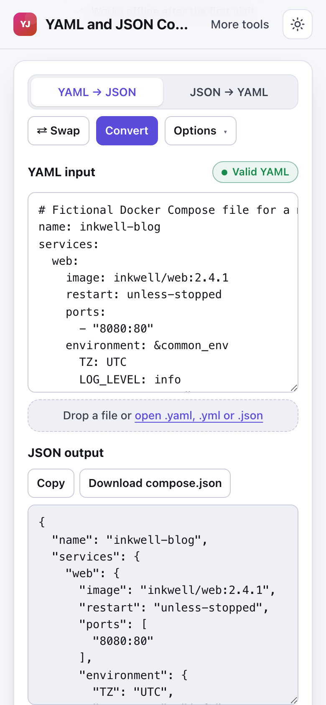

# YAML and JSON Converter

> Validate YAML and convert it to JSON and back in your browser with exact error lines.

**🌐 Use it now: [turhe123.github.io/yaml-json-converter](https://turhe123.github.io/yaml-json-converter/)** · free · open source · runs in your browser · works offline


## Why

YAML and JSON Converter is a free, open-source alternative to online YAML parsers and YAML to JSON sites, which are often ad supported, send your paste to a server, give poor error locations, or convert in only one direction. Here your files never leave the device, there is no account, no ads and no limits, it works offline, and it can be installed as an app.

## Screenshots

<p align="center"></p>

<p align="center"><em>YAML and JSON Converter in the browser, light theme</em></p>

<p align="center"></p>

<p align="center"><em>YAML and JSON Converter on a phone</em></p>

## Features

- Two linked editors with a YAML to JSON / JSON to YAML switch, and a Swap button that moves the output into the input and flips the direction.
- Live conversion as you type (about 200 ms debounce), plus Ctrl/Cmd + Enter to convert now.
- A validity badge (Empty, Valid, Valid with document count, or Error with the line number).
- Exact errors: line, column, a code snippet with a caret, and a "Go to line" button that selects the spot in the input.
- Plain-language advice for common mistakes: tabs used for indentation, a missing space after a colon, duplicate keys, undefined aliases, curly smart quotes, and JSON trailing commas, single quotes and comments.
- Multi-document YAML (separated by `---`) becomes a JSON array.
- Anchors, aliases and merge keys are resolved on conversion, with a note saying they were expanded.
- Safe loading mode (on by default) that refuses custom tags; turn it off to keep tags as `{ "!Tag": value }`.
- Options: indent of 2 or 4 spaces, YAML 1.2 core or YAML 1.1 schema (yes/no/on/off as booleans), block or flow output style, sort keys A–Z, and fold YAML lines at 80 characters.
- Careful with values: timestamps become ISO strings in JSON, leading-zero values stay as strings, integers beyond ±2^53 are kept as strings with a warning, `.inf` and `.nan` become strings with a warning, Unicode and emoji are preserved, and a byte order mark is removed.
- Copy and Download buttons. The download is named `converted.json` or `converted.yaml`, or reuses the name of the file you opened. Ctrl/Cmd + S downloads.
- Open or drop a file onto the page or the input box (one file at a time; others are skipped with a message).
- Inputs of about 2 million characters or more are converted in a Web Worker, with a progress bar.
- Responsive layout: panes side by side on wide screens, stacked on phones. Light and dark themes.
- A sample loads on first visit. Empty input shows a calm placeholder instead of an error.

**Formats:** input `.yaml`, `.yml`, `.json` (or pasted text); output JSON or YAML.

**Limits:** one file at a time; nothing is stored between visits; very large documents are limited only by your device's memory.

## How to use

1. Paste YAML (or JSON) into the left editor, or drop a `.yaml`, `.yml` or `.json` file. Dropping a file picks the direction from its extension.
2. Pick the direction with the segmented control. The result updates as you type; open Options to change indent, schema, style or key sorting.
3. If something is wrong, read the error box: it shows the line, column and a caret. Use "Go to line" to jump there.
4. Copy the result, or download it as `converted.json` / `converted.yaml`.
5. Use Swap to send the output back into the input and convert in the other direction.

## Privacy

- Nothing is uploaded. Conversion happens entirely in your browser.
- No cookies, no accounts, nothing stored.
- Page views are counted anonymously with [GoatCounter](https://www.goatcounter.com/) (cookieless, open source).
- Works offline through a service worker once the page has loaded.

## Run it locally

```
git clone https://github.com/turhe123/yaml-json-converter
cd yaml-json-converter
python3 -m http.server 4173
```

Then open http://127.0.0.1:4173/. There is no build step.

## Tests

```
npm i -D @playwright/test && npx playwright install chromium
npx playwright test
```

## Third-party code

- [js-yaml](https://github.com/nodeca/js-yaml) 4.1.0, MIT license (in `vendor/js-yaml/`).

## Built with AI

YAML and JSON Converter was written by [Claude Code](https://claude.com/claude-code) inside an automated pipeline, from a plain-English spec. No code or assets from any commercial product were used; it is a clean-room implementation of a feature set, not a copy.

What that means in practice:

- The full source is in this repo under the MIT license. Read it before you trust it with your files.
- Everything runs in your browser. It makes no network requests except an anonymous, cookieless page-view count (GoatCounter); your files never leave the device.
- The page is tested headless in Chromium (Playwright) before every release, but it has had less human review than hand-written software. Bug reports and pull requests are welcome.

## Support ❤️

If this saved you some time, you can support the project on [Ko-fi](https://ko-fi.com/leodavidai).

## More free web tools

Find more at [turhe123.github.io/web-tools](https://turhe123.github.io/web-tools/).

## License

MIT © Or Davidai Bachar
